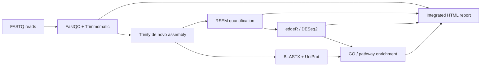
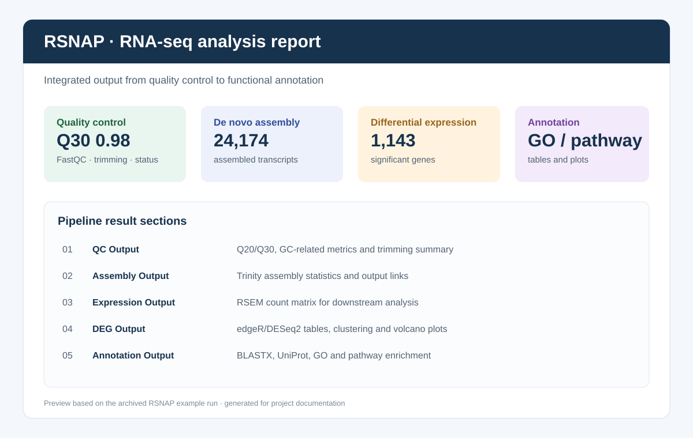

# RSNAP

RSNAP is an automated de novo RNA-seq analysis pipeline developed as a 2023 undergraduate graduation project.

It integrates quality control, read trimming, transcriptome assembly, expression quantification, differential expression analysis, protein-level transcript identification, functional annotation, enrichment analysis, and HTML report generation into one configurable workflow.

## Pipeline



The module relationships are shown in [`docs/architecture.md`](docs/architecture.md).



## Main capabilities

- Configuration-driven sample groups, sequencing layout, output paths, and analysis thresholds.
- Automatic parsing of FastQC output, including Q20/Q30, GC-related metrics, quality status, and trimming positions.
- De novo transcriptome assembly with Trinity.
- Expression matrix generation with RSEM.
- Differential expression analysis through edgeR or DESeq2 via `rpy2`.
- UniProt query, BLASTX-based transcript identification, and annotation merging.
- GO/pathway enrichment analysis with GSEApy.
- Intermediate-result tracking and a consolidated Jinja2 HTML report.

## Repository layout

The maintained pipeline modules are under [`script/`](script/). The repository also preserves dated snapshots and development records from the original project.

| Path | Purpose |
| --- | --- |
| [`script/RSNAP.py`](script/RSNAP.py) | Pipeline orchestrator |
| [`script/config.py`](script/config.py) | Sample, group, and analysis configuration |
| [`script/Quality_Control.py`](script/Quality_Control.py) | FastQC parsing and read trimming |
| [`script/Assemble_trinity.py`](script/Assemble_trinity.py) | Trinity assembly |
| [`script/Expression_evaluation_rsem.py`](script/Expression_evaluation_rsem.py) | RSEM quantification |
| [`script/Differential_expression_gene_identification.py`](script/Differential_expression_gene_identification.py) | edgeR/DESeq2 analysis |
| [`script/Transcript_identification.py`](script/Transcript_identification.py) | UniProt and BLASTX identification |
| [`script/Feature_annotation_analysis.py`](script/Feature_annotation_analysis.py) | Annotation and enrichment |
| [`report_template.html`](report_template.html) | Integrated report template |

## Example run

Copy [`examples/config.example.py`](examples/config.example.py) to a working directory, replace the sample paths and groups, and run the pipeline from the `script/` directory:

```bash
cp examples/config.example.py config.py
cd script
python RSNAP.py --config ../config.py --check
```

The complete workflow requires external bioinformatics software, including FastQC, Trimmomatic, Trinity, RSEM/Bowtie2, BLAST+, R, and the required R/Python packages. UniProt annotation retrieval also requires network access.

The lightweight checks in [`tests/`](tests/) validate source syntax and configuration structure without running the external bioinformatics programs.

## Example output

The local project archive contains an HTML report from a complete analysis run with quality-control summaries, Trinity assembly statistics, expression quantification, differential expression results, BLASTX identification, and functional annotation plots. Generated datasets and reports are kept outside the source repository because they are large and dataset-specific.

The example run reported 12,992 assembled genes, 24,174 transcripts, and 1,143 significant differentially expressed genes under the configured thresholds. These values belong to the archived example dataset and are not universal pipeline benchmarks.

The project-focused Chinese and English resume descriptions are available in [`docs/career-summary.md`](docs/career-summary.md).

## Project contribution

The main contribution is workflow engineering: turning a multi-tool de novo transcriptomics protocol into a configurable, restart-aware analysis pipeline with unified outputs and a readable report. The project demonstrates Python orchestration, command-line tool integration, Python/R interoperability, result parsing, and scientific reporting.

## Historical note

This project was developed manually in 2023, before the current wave of AI-assisted coding tools. The dated folders and development documents are intentionally retained as part of the project history.

## Development checks

```bash
python -m compileall script tests
python -m unittest discover -s tests -v
```


