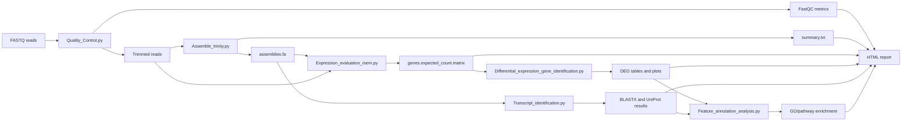

# RSNAP architecture

RSNAP is organized as a Python orchestrator around established command-line and R-based bioinformatics tools. Each stage writes files into a dedicated output directory and records paths for downstream stages.

## Control flow

`script/RSNAP.py` reads the configuration, creates output directories, invokes each stage, checks for existing outputs, and assembles the final Jinja2 report. The stage scripts can also be run independently through their Click command-line interfaces.

## Data flow

The workflow keeps the biological data units explicit: reads are used for quality control and assembly; assembled transcripts are used for quantification and BLASTX identification; count matrices are used for differential analysis; annotated transcript IDs are used for enrichment analysis.

## External tools

FastQC and Trimmomatic handle read quality, Trinity performs de novo assembly, RSEM estimates expression, edgeR or DESeq2 performs differential analysis, BLAST+ and UniProt provide protein-level identification, and GSEApy produces enrichment results and plots.
